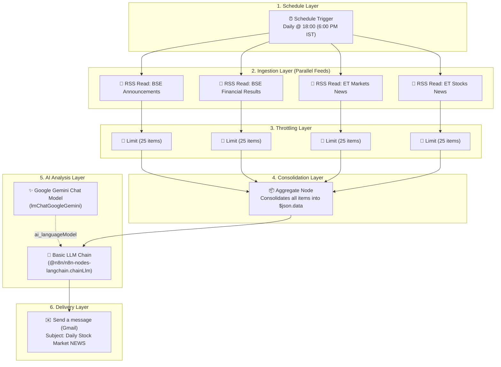
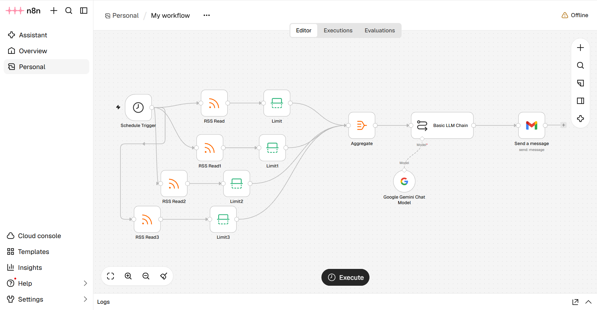
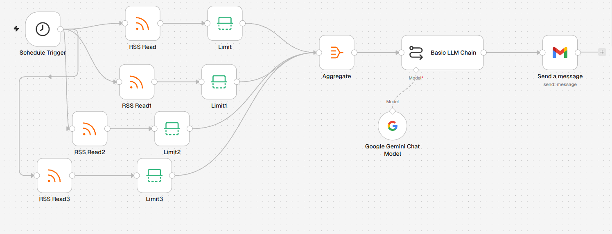

# AI Indian Stock Market News Agent 📈🇮🇳

[](https://n8n.io/)
[](https://deepmind.google/technologies/gemini/)
[](https://www.langchain.com/)
[](https://developers.google.com/gmail/api)
[](LICENSE)

An automated, AI-driven financial intelligence agent that monitors regulatory filings and financial news from the **Bombay Stock Exchange (BSE)** and **The Economic Times**, extracts market-moving developments, synthesizes a structured evening briefing using **Google Gemini LLM**, and delivers it straight to your **Gmail inbox** every evening at **6:00 PM IST**.

---

## 📑 Table of Contents

- [Overview](#overview)
- [Problem Statement](#problem-statement)
- [Project Objectives](#project-objectives)
- [Key Features](#key-features)
- [System Architecture](#system-architecture)
- [Workflow Visuals](#workflow-visuals)
- [Detailed Node-by-Node Explanation](#detailed-node-by-node-explanation)
- [How It Works (Step-by-Step)](#how-it-works-step-by-step)
- [Technologies Used](#technologies-used)
- [Prerequisites & Installation](#prerequisites--installation)
- [Importing the Workflow into n8n](#importing-the-workflow-into-n8n)
- [Credential Configuration](#credential-configuration)
  - [1. Google Gemini API](#1-google-gemini-api)
  - [2. Gmail OAuth2](#2-gmail-oauth2)
  - [3. RSS Feed Verification](#3-rss-feed-verification)
- [Schedule Configuration (6:00 PM IST)](#schedule-configuration-600-pm-ist)
- [Security & Privacy](#security--privacy)
- [Limitations](#limitations)
- [Future Improvements & Roadmap](#future-improvements--roadmap)
- [Disclaimer](#disclaimer)
- [Author & Acknowledgments](#author--acknowledgments)

---

## 📌 Overview

Retail investors, market researchers, and finance enthusiasts often struggle to keep up with hundreds of daily corporate announcements, financial statements, and news articles published across multiple exchanges and news outlets after Indian markets close.

The **AI Indian Stock Market News Agent** solves this through an autonomous, end-to-end pipeline built in **n8n**. It runs every day at 6:00 PM IST (post-market close), ingests live feeds from BSE India and Economic Times, strips out noise, groups the data, applies strict prompt-engineered financial analysis via Google Gemini, and delivers a professional digest directly to the user's email.

---

## 🔍 Problem Statement

1. **Information Overload**: BSE and NSE list thousands of companies. Sifting through raw filings and media outlets manually takes hours every evening.
2. **Noise vs. Signal**: Many press releases are administrative or repetitive; identifying actionable corporate shifts (earnings, mergers, regulatory actions) is difficult.
3. **Timing Inefficiencies**: The Indian stock market closes at 3:30 PM IST, but high-impact announcements and corporate board resolutions continue through 5:30 PM. Manual review after market hours is tedious.
4. **Scattered Sources**: Crucial information is split between official regulatory portals (BSE) and mainstream financial news portals (The Economic Times).

---

## 🎯 Project Objectives

- **Automate Data Harvesting**: Continuously collect verified filings and news from multiple trusted sources.
- **Normalize & Cap Throughput**: Prevent token saturation and rate limits using structured data aggregation and item limits.
- **Synthesize with AI Guardrails**: Use Google Gemini with strict prompt constraints forbidding hallucinated prices or unsolicited trading advice.
- **Deliver Zero-Touch Reports**: Automatically format and email a cohesive 5-part briefing every business evening.

---

## 🌟 Key Features

- ⏰ **Scheduled Execution**: Automates daily at 6:00 PM IST, immediately capturing post-market filings.
- 📡 **Multi-Source RSS Ingestion**: Ingests simultaneously from:
  - BSE Official Corporate Announcements
  - BSE Financial Results Feed
  - Economic Times Markets Feed
  - Economic Times Stocks Feed
- 🛑 **Intelligent Throttling**: Caps each feed to 25 items to ensure balanced representation and optimize token usage.
- 📦 **Data Aggregation**: Unifies disparate feeds into a single structured array for downstream language models.
- 🧠 **LangChain & Gemini LLM Integration**: Uses an engineered persona instructing Gemini to act as an objective market analyst.
- 🛡️ **Anti-Hallucination Guardrails**: Explicitly prevents fabricated numbers, requires source links, and distinguishes factual reports from interpretations.
- 📬 **Automated Email Dispatch**: Sends the complete briefing directly to the configured recipient via Gmail.

---

## 🏗️ System Architecture

The following diagram illustrates the verified workflow executed inside n8n:



> For full architectural details, data schemas, and design rationales, refer to [`docs/architecture.md`](docs/architecture.md).

---

## 📸 Workflow Visuals

### Full Workflow Overview (n8n Editor)
Below is the complete canvas view captured directly from the live n8n workflow interface:



### Node Graph & Data Flow Detail
A focused view of the node connections, sub-node bindings, and LangChain integration:



---

## 🧩 Detailed Node-by-Node Explanation

| Node Name | Type / Package | Purpose & Configuration |
|---|---|---|
| **Schedule Trigger** | `n8n-nodes-base.scheduleTrigger` | Triggers the flow every day at hour 18 (6:00 PM). Timing is synchronized with the closing of Indian market disclosures. |
| **RSS Read** | `n8n-nodes-base.rssFeedRead` | Fetches regulatory disclosures from `https://www.bseindia.com/data/xml/announcements.aspx`. |
| **RSS Read1** | `n8n-nodes-base.rssFeedRead` | Fetches corporate quarterly and annual financial statements from `https://www.bseindia.com/Data/XML/FinancialResultsFeed.aspx`. |
| **RSS Read2** | `n8n-nodes-base.rssFeedRead` | Fetches macro market news and index movements from `https://economictimes.indiatimes.com/markets/rssfeeds/1977021501.cms`. |
| **RSS Read3** | `n8n-nodes-base.rssFeedRead` | Fetches stock-specific updates and sector reports from `https://economictimes.indiatimes.com/markets/stocks/rssfeeds/2146842.cms`. |
| **Limit, Limit1, Limit2, Limit3** | `n8n-nodes-base.limit` | Caps each stream at `maxItems: 25`, ensuring high-relevance sampling and preventing token limit exhaustion. |
| **Aggregate** | `n8n-nodes-base.aggregate` | Uses `aggregateAllItemData` to bundle all incoming article objects into a unified array (`$json.data`). |
| **Basic LLM Chain** | `@n8n/n8n-nodes-langchain.chainLlm` | The reasoning orchestrator. Formats `$json.data` and invokes the language model with an exhaustive market analyst prompt. |
| **Google Gemini Chat Model** | `@n8n/n8n-nodes-langchain.lmChatGoogleGemini` | Connects Google's Gemini LLM as the sub-node language model for the LLM chain. |
| **Send a message** | `n8n-nodes-base.gmail` | Dispatches the synthesized report (`$json.text`) to the specified email address via Gmail OAuth2. |

---

## ⚙️ How It Works (Step-by-Step)

```
[18:00 IST Trigger] 
       ⬇
[4x Parallel RSS Fetch] 
       ⬇
[4x Throttling (25 items each)] 
       ⬇
[Consolidation in Aggregate Node] 
       ⬇
[Gemini Structured Synthesis] 
       ⬇
[Gmail Dispatch to Inbox]
```

1. **Trigger**: At 18:00 IST, the Schedule Trigger fires.
2. **Parallel Ingestion**: 4 HTTP requests are made simultaneously to BSE and Economic Times RSS feeds.
3. **Filtering & Normalization**: The 4 `Limit` nodes ensure a maximum of 100 items (up to 25 from each source) enter the aggregation pipeline.
4. **Data Aggregation**: The `Aggregate` node compiles the individual JSON streams into a single list of articles.
5. **AI Synthesis**: The `Basic LLM Chain` serializes the data into JSON and instructs Google Gemini with a prompt specifying:
   - **Section 1**: Top 5 Headlines (with impact tags: Positive / Negative / Neutral, investor context, and original URL).
   - **Section 2**: Sector-Wise Developments (Banking, IT, Pharma, Auto, Energy, etc.).
   - **Section 3**: Market Sentiment (Evidence-based Bullish/Bearish/Neutral summary).
   - **Section 4**: Important Stocks to Watch (Notable corporate activity without investment recommendations).
   - **Section 5**: Final Takeaway.
6. **Delivery**: The synthesized briefing is passed to the Gmail node, which transmits the message directly to the recipient's inbox.

---

## 💻 Technologies Used

- **Workflow Orchestration**: [n8n](https://n8n.io/) (v1.x Self-hosted / Cloud)
- **AI / LLM Framework**: [LangChain Nodes for n8n](https://docs.n8n.io/integrations/builtin/cluster-nodes/root-nodes/n8n-nodes-langchain.chainllm/)
- **Foundation Model**: [Google Gemini](https://ai.google.dev/)
- **Data Protocols**: RSS 2.0 / XML / JSON
- **Email Service**: Google Workspace / Gmail API (OAuth2)

---

## 🚀 Prerequisites & Installation

### 1. Requirements
- An active instance of **n8n** (Cloud or self-hosted via Docker / npm).
- A **Google Cloud / Gemini API key** (obtainable from [Google AI Studio](https://aistudio.google.com/)).
- A **Google / Gmail account** with API access enabled.

### 2. Running n8n Locally (Docker Example)
If you do not have n8n running, launch it with Docker:

```bash
docker run -it --rm \
  --name n8n \
  -p 5678:5678 \
  -v ~/.n8n:/home/node/.n8n \
  docker.n8n.io/n8nio/n8n
```

Navigate to `http://localhost:5678` in your browser to complete initial setup.

---

## 📥 Importing the Workflow into n8n

1. Download or clone this repository:
   ```bash
   git clone https://github.com/Hariprasad1-hub/AI-Indian-Stock-Market-News-Agent.git
   ```
2. Open your n8n dashboard.
3. In the top navigation, click on **Workflows** ➔ **Add workflow** (or click the **`+`** icon).
4. Click the three dots menu (**`⋮`**) in the top right corner and select **Import from File**.
5. Select [`workflow/daily-stock-news.json`](workflow/daily-stock-news.json).
6. The full 13-node canvas will appear immediately.

---

## 🔑 Credential Configuration

### 1. Google Gemini API
1. Go to [Google AI Studio](https://aistudio.google.com/) and create an API Key.
2. In n8n, double-click the **Google Gemini Chat Model** node.
3. In the **Credential for Google Gemini** dropdown, click **Create New Credential**.
4. Paste your API Key into the **API Key** field and save.

### 2. Gmail OAuth2
1. In n8n, double-click the **Send a message** (Gmail) node.
2. Under **Credential to connect with**, select **Create New Credential** (Gmail OAuth2).
3. Follow n8n's guided OAuth flow (or use your own GCP OAuth Client ID and Secret if self-hosting).
4. In the **Send To** field, replace `your-email@example.com` with your actual recipient email address.

### 3. RSS Feed Verification
The workflow uses public RSS endpoints that require no authentication:
- `https://www.bseindia.com/data/xml/announcements.aspx`
- `https://www.bseindia.com/Data/XML/FinancialResultsFeed.aspx`
- `https://economictimes.indiatimes.com/markets/rssfeeds/1977021501.cms`
- `https://economictimes.indiatimes.com/markets/stocks/rssfeeds/2146842.cms`

---

## ⏰ Schedule Configuration (6:00 PM IST)

The workflow is pre-configured to trigger at hour **18** (6:00 PM).

To verify or change this:
1. Double-click the **Schedule Trigger** node.
2. Verify **Trigger at Hour** is set to `18`.
3. Ensure your n8n instance timezone is set to `Asia/Kolkata` (IST):
   - In self-hosted n8n, set environment variable `GENERIC_TIMEZONE=Asia/Kolkata`.
   - In n8n Cloud, configure the timezone under **Settings ➔ Workflow Defaults**.

---

## 🔒 Security & Privacy

- **No Secrets in Repo**: All API keys, credentials, and OAuth tokens have been stripped from [`workflow/daily-stock-news.json`](workflow/daily-stock-news.json).
- **Sanitized Placeholders**: Recipient emails use dummy placeholders (`your-email@example.com`).
- **Protected File Patterns**: `.gitignore` strictly excludes `.env` files, credentials, local OS artifacts (`desktop.ini`), and raw un-sanitized exports.

---

## ⚠️ Limitations

- **RSS Upstream Availability**: Dependent on BSE India and Economic Times uptime and feed structure.
- **Context Window / Token Limits**: A hard cap of 25 items per feed is applied to stay within safe token limits.
- **Single Recipient Delivery**: In its current form, emails are dispatched to one configured address.
- **Language**: The current production workflow generates briefings exclusively in **English**.

---

## 🔮 Future Improvements & Roadmap

- [ ] **Telugu & Vernacular Translation**: Add a Google Translate / Gemini Multilingual node after the LLM chain to produce daily briefings in regional Indian languages (Telugu, Hindi, Tamil).
- [ ] **Multi-Channel Dispatch**: Integrate Telegram Bot and WhatsApp Business API webhooks for mobile-first instant messaging.
- [ ] **HTML Email Template**: Upgrade the email body from plain text to a styled, responsive HTML layout with sentiment color tags.
- [ ] **NSE India Integration**: Add National Stock Exchange (NSE) corporate filing feeds.
- [ ] **Automated Sentiment Analytics Dashboard**: Log daily sentiment ratings to Google Sheets or Notion for long-term trend analysis.

---

## ⚖️ Disclaimer

> [!IMPORTANT]
> **Educational & Informational Purpose Only**: This project is developed purely for academic, learning, and automated news summarization purposes. It does **NOT** constitute financial, investment, or legal advice. The creator is not a SEBI-registered financial advisor. Always conduct your own research or consult a licensed professional before making financial decisions.

---

## 👤 Author & Acknowledgments

- **Developer**: Hariprasad ([@Hariprasad1-hub](https://github.com/Hariprasad1-hub))
- **Repository**: [AI-Indian-Stock-Market-News-Agent](https://github.com/Hariprasad1-hub/AI-Indian-Stock-Market-News-Agent)
- Built with [n8n](https://n8n.io/) and [Google DeepMind Gemini](https://deepmind.google/technologies/gemini/).

