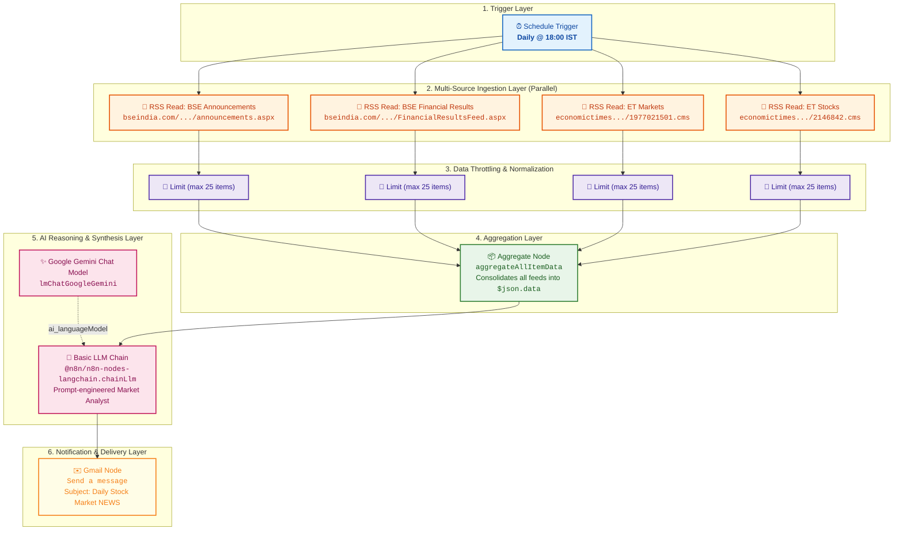

# Architecture & Technical Deep Dive

This document provides a technical breakdown of the **AI Indian Stock Market News Agent**, detailing its data pipeline, node configurations, data models, and architectural decisions.

---

## 1. High-Level System Architecture

The automation follows an event-driven Extract, Transform, Analyze, and Load (ETAL) design implemented natively in **n8n** with **LangChain** nodes and **Google Gemini**:



---

## 2. Pipeline Stages & Node Breakdown

### Stage 1: Trigger Layer
- **Node**: `Schedule Trigger` (`n8n-nodes-base.scheduleTrigger`)
- **Trigger Rule**: Daily at `triggerAtHour: 18` (6:00 PM).
- **Execution Timing**: Timed for 6:00 PM Indian Standard Time (IST), exactly 2.5 hours after the Indian market cash session closes at 3:30 PM IST. This ensures all post-market exchange filings, corporate board meeting resolutions, and closing market wraps have been syndicated.

### Stage 2: Ingestion Layer (Parallel RSS Extraction)
To capture both official regulatory disclosures and broader market commentary, the workflow fans out to 4 distinct endpoints simultaneously:

| Node Name | Source Type | URL | Purpose |
|---|---|---|---|
| `RSS Read` | Regulatory (BSE) | `https://www.bseindia.com/data/xml/announcements.aspx` | Corporate actions, regulatory notices, AGM/EGM filings |
| `RSS Read1` | Regulatory (BSE) | `https://www.bseindia.com/Data/XML/FinancialResultsFeed.aspx` | Quarterly earnings reports, balance sheets, profit declarations |
| `RSS Read2` | Financial Media | `https://economictimes.indiatimes.com/markets/rssfeeds/1977021501.cms` | Macro market trends, indices (NIFTY/SENSEX), RBI updates |
| `RSS Read3` | Financial Media | `https://economictimes.indiatimes.com/markets/stocks/rssfeeds/2146842.cms` | Specific stock movements, broker target prices, sector highlights |

### Stage 3: Rate Limiting & Throttling
- **Nodes**: `Limit`, `Limit1`, `Limit2`, `Limit3` (`n8n-nodes-base.limit`)
- **Configuration**: `maxItems: 25` per feed.
- **Rationale**:
  1. Prevents token buffer overflow in the downstream LLM.
  2. Protects against rate limits and execution latency spikes during high-volatility news spikes.
  3. Guarantees balanced representation across feeds (up to 50 regulatory items + 50 financial news items).

### Stage 4: Aggregation Layer
- **Node**: `Aggregate` (`n8n-nodes-base.aggregate`)
- **Configuration**: Mode `aggregateAllItemData`.
- **Function**: Merges separate item streams from all 4 branches into a single JSON array exposed at `$json.data`. This unified payload is forwarded as a consolidated context object to the LLM.

### Stage 5: Intelligence & Synthesis Layer
- **Nodes**:
  - `Basic LLM Chain` (`@n8n/n8n-nodes-langchain.chainLlm` v1.9)
  - `Google Gemini Chat Model` (`@n8n/n8n-nodes-langchain.lmChatGoogleGemini` v1.2)
- **Input Expression**: `NEWS DATA: {{ JSON.stringify($json.data) }}`
- **System Prompt Objectives**:
  - Role: Senior Indian Stock Market News Analyst.
  - Verification: Exclusively synthesize from supplied news; do not invent stock prices, targets, or predictions.
  - Output Sections:
    1. **Top 5 Important Headlines** (with ticker/sector, impact assessment: Positive/Negative/Neutral, investor rationale, and source URL).
    2. **Sector-wise Developments** (Banking, IT, Pharma, Auto, Energy, FMCG).
    3. **Market Sentiment** (Data-backed Bullish/Bearish/Neutral assessment).
    4. **Important Stocks to Watch** (Fact-based observation, no financial advice).
    5. **Final Takeaway**.

### Stage 6: Delivery Layer
- **Node**: `Send a message` (`n8n-nodes-base.gmail` v2.2)
- **Configuration**:
  - Subject: `Daily Stock Market NEWS`
  - Message Body: `={{ $json.text }}`
- **Authentication**: Gmail OAuth2.

---

## 3. Data Flow & Payload Transformations

```
Raw RSS XML 
  ──(RSS Read Nodes)──▶ Array of ~10-100 Individual Item Objects
  ──(Limit Nodes)──▶ Array capped at 25 items per source
  ──(Aggregate Node)──▶ Consolidated Object: { "data": [ { title, link, description, pubDate }, ... ] }
  ──(Basic LLM Chain)──▶ Structured Markdown/Plaintext Intelligence Report: { "text": "..." }
  ──(Gmail Node)──▶ Email Dispatched to Recipient Inbox
```

---

## 4. Key Design Decisions

1. **Parallel vs. Sequential Ingestion**:
   Connecting all 4 RSS nodes directly from the Schedule Trigger allows simultaneous network requests, reducing total execution time compared to a serial chain.
2. **Deterministic Prompting**:
   The prompt enforces strict constraints forbidding speculative financial advice and requiring original links, making the output reliable and audit-friendly.
3. **Decoupled Model Architecture**:
   Using LangChain abstractions in n8n allows swapping the LLM provider (e.g. Gemini, OpenAI, Claude, or local Ollama) by connecting a different model node to `Basic LLM Chain` without modifying the core pipeline.

